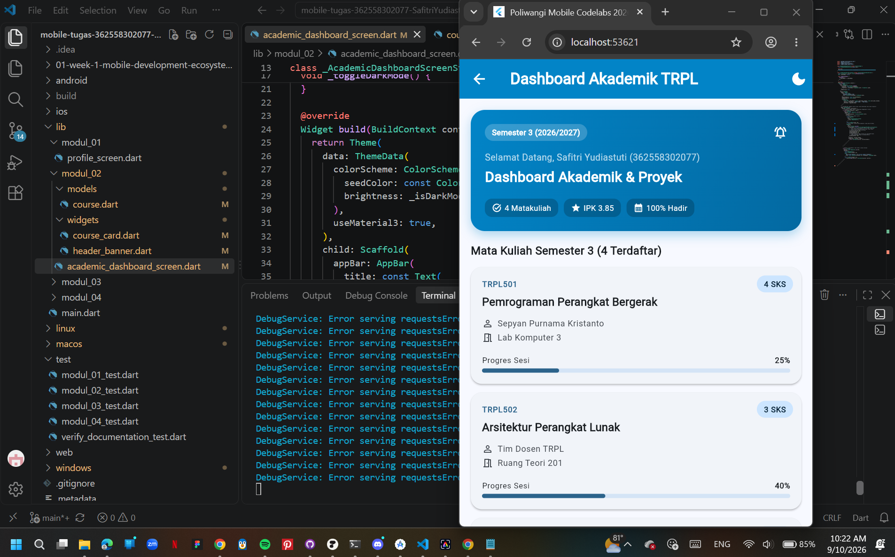
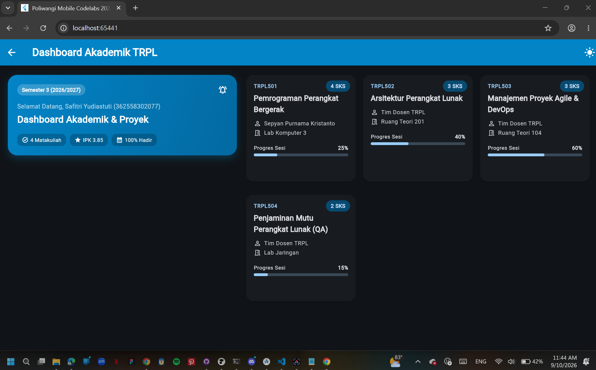
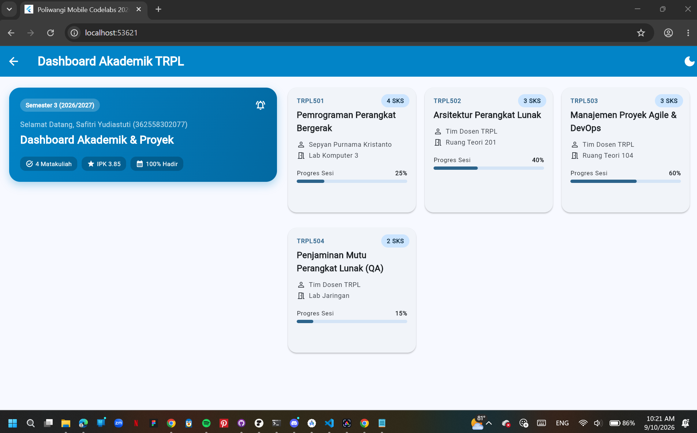

# Laporan Praktikum Modul 02: Declarative UI & Responsive Layout

- **Nama**: Safitri Yudiastuti
- **NIM**: 362558302077
- **Kelas / Prodi**: 2E / Sarjana Terapan TRPL
- **Mata Kuliah**: Pemrograman Perangkat Bergerak (Semester 3)

---

## 1. Ringkasan Implementasi

Dashboard akademik (`AcademicDashboardScreen`) dirancang responsif menggunakan `LayoutBuilder`, yang membaca lebar layar (`constraints.maxWidth`) secara langsung tanpa perlu package tambahan atau `MediaQuery`. Breakpoint ditetapkan di 600dp:

- **Lebar < 600dp (mode HP / portrait)**: layout memakai `ListView` satu kolom vertikal, menampilkan `HeaderBanner` di atas, diikuti daftar mata kuliah dalam bentuk `CourseCard` yang disusun berurutan ke bawah.
- **Lebar ≥ 600dp (mode tablet / landscape)**: layout berubah menjadi `Row` dua kolom — kolom kiri (`flex: 2`) menampilkan `HeaderBanner` di dalam `SingleChildScrollView`, kolom kanan (`flex: 3`) menampilkan daftar mata kuliah dalam bentuk grid menggunakan `GridView.builder` dengan `SliverGridDelegateWithMaxCrossAxisExtent` (lebar kartu maksimal 340dp, sehingga jumlah kolom grid menyesuaikan otomatis dengan ruang yang tersedia).

Untuk tema, digunakan Material 3 (`useMaterial3: true`) dengan `ColorScheme.fromSeed(seedColor: Color(0xFF0284C7))`. Mode gelap/terang dikontrol lewat satu variabel state `_isDarkMode`, yang diteruskan ke properti `brightness` pada `ColorScheme`. Karena `ThemeData` didefinisikan terpusat di root widget (`Theme`), seluruh child widget (AppBar, Card, Text, dsb.) otomatis menyesuaikan warna tanpa perlu diatur manual satu per satu.

## 2. Bukti Tangkapan Layar (Running App)

| Mode Portrait (Light) | Mode Dark Theme | Mode Landscape / Tablet (2 Kolom) |
|---|---|---|
|  |  |  |

*(Ambil screenshot langsung dari emulator/device Anda saat `flutter run`, lalu simpan ke folder `screenshots/` dengan nama file sesuai di atas.)*

## 3. Kendala Layout yang Dihadapi & Solusinya

- **Kendala**: Saat awal menyusun `GridView.builder` untuk mode tablet, penggunaan `childAspectRatio` bersamaan dengan `mainAxisExtent` menyebabkan konflik ukuran — tinggi kartu jadi tidak konsisten dan sebagian isi `CourseCard` terpotong (overflow).
- **Solusi**: Hanya menggunakan salah satu, yaitu `mainAxisExtent: 240` sebagai tinggi tetap tiap kartu, dan tidak mengombinasikannya dengan `childAspectRatio`. Dengan tinggi eksplisit ini, seluruh isi `CourseCard` (judul, kategori, dsb.) selalu muat tanpa overflow, terlepas dari lebar kolom yang berubah-ubah mengikuti `maxCrossAxisExtent`.

## 4. Jawaban Pertanyaan Refleksi

1. **Efisiensi Single-pass BoxConstraints**: Flutter menata layout dengan mekanisme "parent memberi constraints ke child, child mengembalikan ukuran ke parent" hanya dalam satu kali lintasan (single-pass), bukan bolak-balik berulang. `LayoutBuilder` memanfaatkan ini dengan membaca `BoxConstraints` yang diteruskan oleh parent-nya secara langsung di dalam `builder`, tanpa perlu menunggu proses render selesai atau melakukan pengukuran ulang lewat `MediaQuery`. Ini membuat keputusan responsif (misalnya memilih 1 kolom atau 2 kolom) diambil lebih cepat dan efisien karena terjadi bersamaan dengan proses layout itu sendiri, bukan sebagai proses tambahan terpisah.

2. **Kriteria Modularisasi Widget**: Sebuah bagian UI layak dipisah menjadi widget sendiri (seperti `HeaderBanner` dan `CourseCard` pada kode ini) apabila: (a) tampilannya dipakai berulang di beberapa tempat, (b) memiliki logika atau state tersendiri yang tidak perlu diketahui oleh widget induk, dan (c) memisahkannya membuat kode induk (`build` method utama) lebih pendek dan mudah dibaca. Pada dashboard ini, `CourseCard` dipisah karena dipanggil berkali-kali dalam loop (`_courses.map(...)` dan `itemBuilder`), sehingga tanpa modularisasi kode akan sangat panjang dan sulit dipelihara.

3. **Manfaat M3 ThemeData Terpusat**: Dengan mendefinisikan `ThemeData` satu kali di root (lewat widget `Theme`), seluruh komponen visual (warna AppBar, warna teks, warna Card, dsb.) mengambil nilainya dari satu sumber (`ColorScheme.fromSeed`). Manfaatnya adalah konsistensi visual terjaga otomatis di seluruh aplikasi, dan saat berpindah mode gelap/terang cukup mengubah satu variabel (`_isDarkMode`) tanpa perlu mengubah kode warna di setiap widget satu per satu.