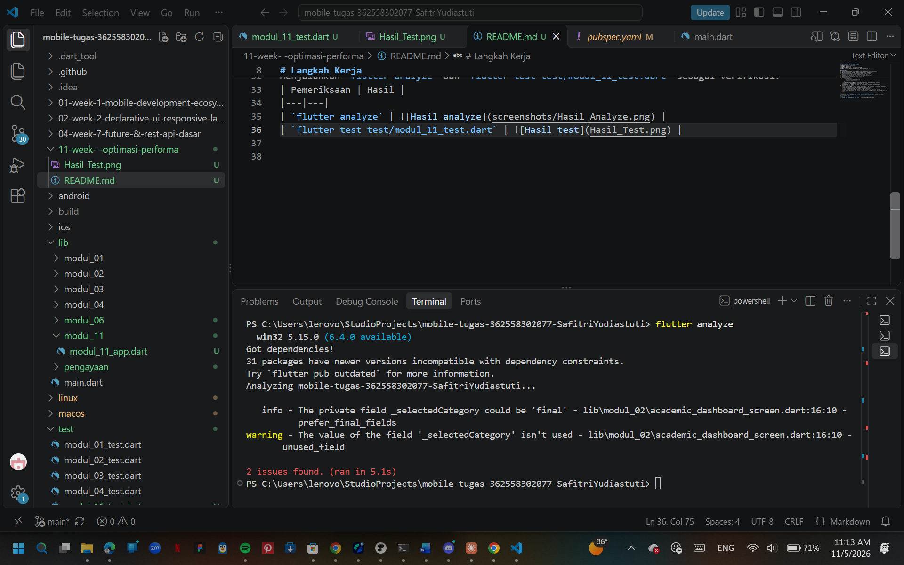
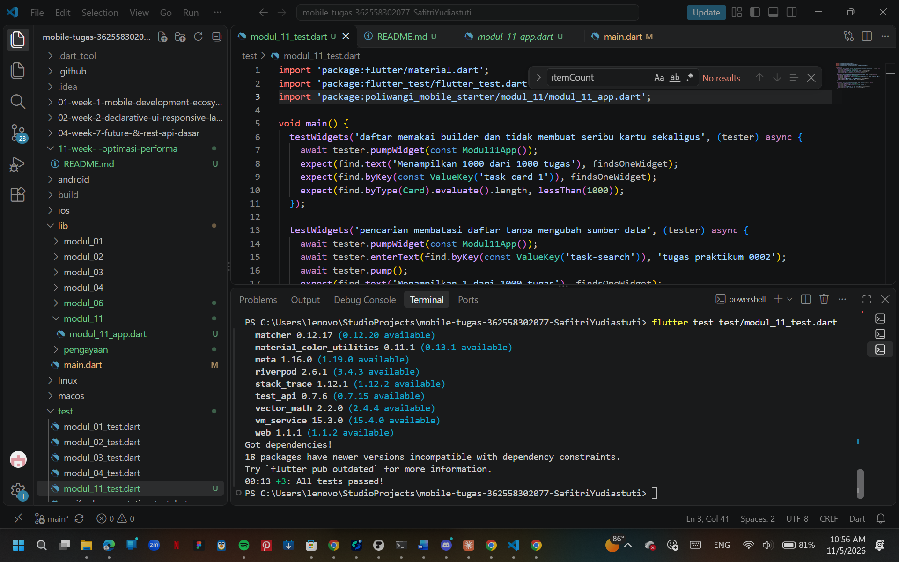
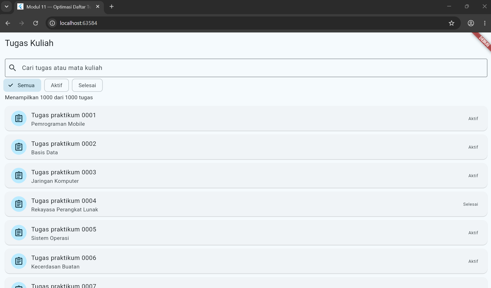
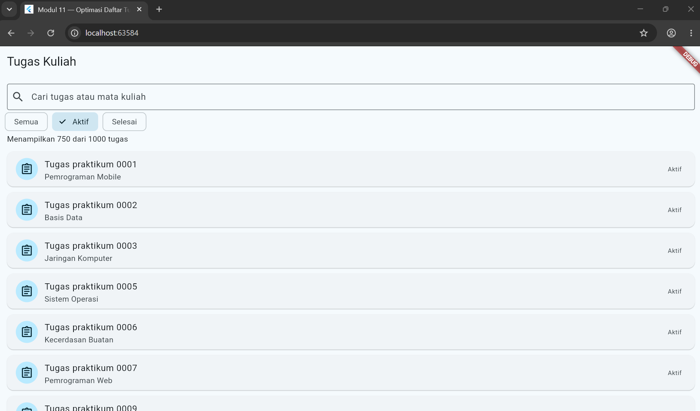
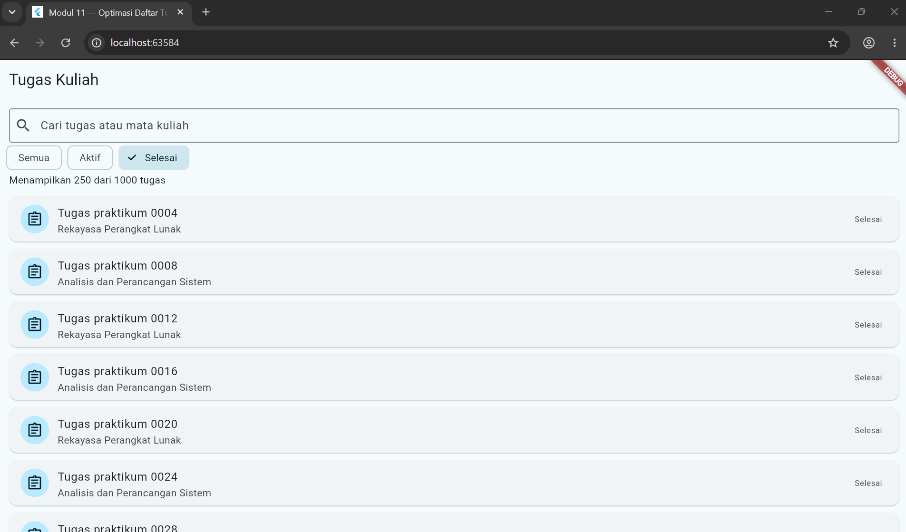
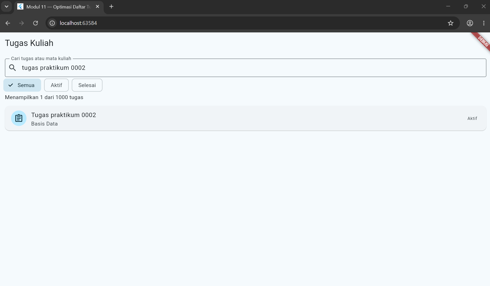

# Praktikum Modul 11 - Optimasi Performa

- **Nama**: Safitri Yudiastuti
- **NIM**: 362558302077
- **Kelas / Prodi**: 2E / Sarjana Terapan TRPL
- **Mata Kuliah**: Pemrograman Perangkat Bergerak (Semester 3)

# Langkah Kerja
1. Saya mengerjakannya di project mobile-tugas-362558302077-SafitriYudiastuti
2. Menjalankan perintah flutter pub get untuk mengunduh dependensi
3. Menyiapkan template yang diberikan oleh dosen yaitu P. Sepyan
    modul_11/modul_11_app.dart dan juga modul_11_test.dart
4. Melakukan test awal dengan flutter test test/modul_11_test.dart
5. Lalu menjalankan aplikasinya dengan flutter run
6. Menelusuri builder 
        ListView.builder(
            key: const ValueKey('task-list'),
            itemCount: hasil.length,
            itemBuilder: (context, index) => _KartuTugas(tugas: hasil[index]),
        ),
    - ListView.builder --> Membuat daftar kartunya sesuai dengan kebutuhan layarnya
    - itemCount --> berapa panjang daftar yang bisa digulir
    - itemBuilder --> membuat satu kartu itu punya index, jadi hanya bisa dipanggil
7. Mengenali data dan filter
    - List.generate(1000, ...) --> membuat data sumber: 1.000 tugas yang disimpan di _semuaTugas
    - enum StatusTugas --> pilihan status tugas (aktif / selesai)
    - _kueri --> menyimpan teks yang diketik di kotak pencarian
    - _hasil --> hasil penyaringan dari _semuaTugas sesuai _kueri dan filter status
    - Jadi _semuaTugas adalah data aslinya (tidak berubah), sedangkan _hasil adalah yang tampil di layar.

Menjalankan `flutter analyze` dan `flutter test test/modul_11_test.dart` sebagai verifikasi.
| Pemeriksaan | Hasil |
|---|---|
| `flutter analyze` |  |
| `flutter test test/modul_11_test.dart` |  |

Catatan :
flutter analyze awalnya menemukan error di lib/pengayaan/modul_06 karena package
shared_preferences dan flutter_secure_storage belum terdaftar. Saya perbaiki dengan
flutter pub add shared_preferences flutter_secure_storage. Sisa 2 masalah (1 info dan
1 warning) ada di modul_02/academic_dashboard_screen.dart, bukan berasal dari Modul 11.

## Tampilan Aplikasi

| Filter Semua | Filter Aktif | Filter Selesai | Pencarian |
|---|---|---|---|
|  |  |  |  |